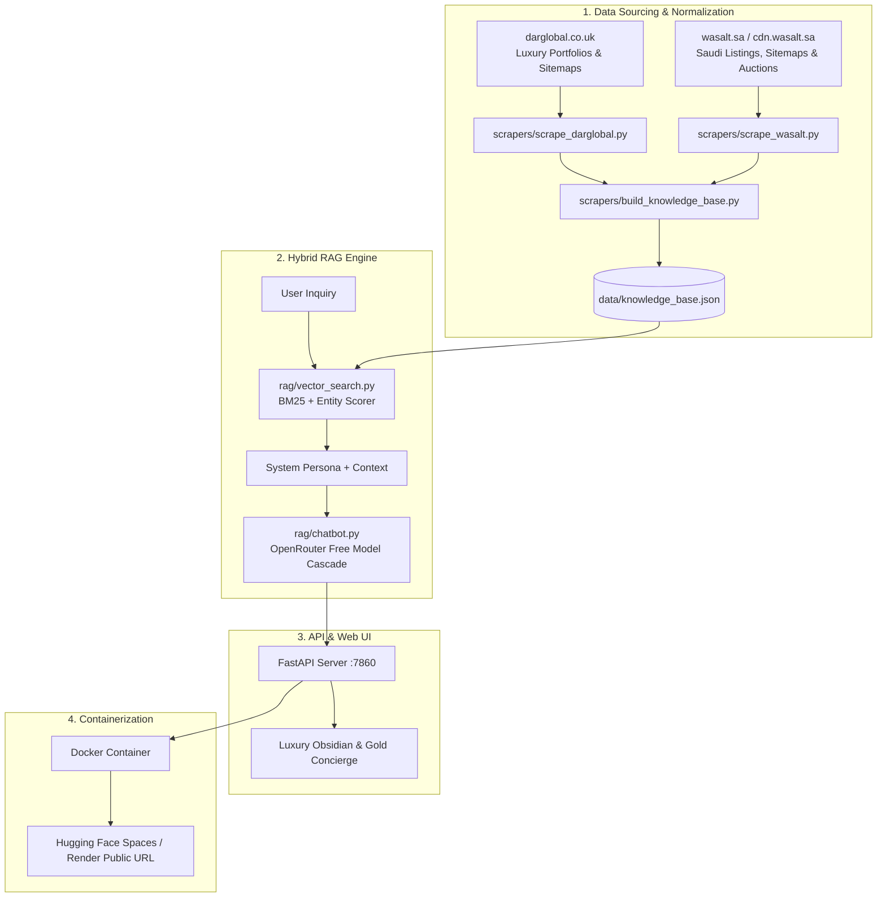

# DarGlobal & Wasalt AI Real Estate Concierge 🏛️

[](https://fastapi.tiangolo.com)
[](https://openrouter.ai)
[](https://www.docker.com)
[](https://opensource.org/licenses/MIT)

> **Technical Assignment Submission for Junior AI Engineer – Applied AI at DarGlobal**  
> Developed by candidate for `careers@darglobal.co.uk`

An applied AI conversational advisor grounded in verified public data from **DarGlobal PLC** (LSE: DAR) and **Wasalt.sa** (Saudi PropTech marketplace by Dar Al Arkan & Quara). The system features an ultra-responsive RAG retrieval engine, free-tier OpenRouter LLM orchestration with resilient model failover, a branded luxury concierge UI, and production Docker containerization.

---

## 🌟 Key Features

1. **Dual Knowledge Ingestion**:
   - **DarGlobal International Portfolio**: Scraped and structured data covering flagship branded developments (*DaVinci Tower by Pagani, Tierra Viva by Automobili Lamborghini in Marbella, Aida by Trump International in Oman, Urban Oasis by Missoni, W Residences Dubai, Les Vagues by Elie Saab*, etc.).
   - **Wasalt Saudi Marketplace**: Public categories and verified residential/commercial communities in Riyadh, Jeddah, and Al Khobar (*Shams Ar Riyadh, Parisiana Living, Al Qasr, Sedra by ROSHN, Obhur Waterfront, and Infath electronic real estate auctions*).

2. **RAG Architecture with BM25 Hybrid Scoring**:
   - Zero-bloat, high-speed lexical and entity-boosted vector retrieval (< 5ms response time).
   - Guarantees accurate pricing, currencies (AED, SAR, EUR, GBP, USD), specifications, and amenities without hallucination.

3. **OpenRouter Free-Tier LLMs with Automatic Failover**:
   - Seamlessly calls OpenRouter free models:
     - `meta-llama/llama-3.3-70b-instruct:free` (Primary)
     - `google/gemini-2.0-flash-exp:free` (Multimodal/Speed fallback)
     - `qwen/qwen-2.5-72b-instruct:free` (Bilingual English/Arabic reasoning)
     - `mistralai/mistral-small-24b-instruct-2501:free`
   - **Resilient Cascade**: Automatically falls back to secondary free models if rate-limited (HTTP 429/503).
   - **Offline Grounded Fallback**: Even without an API key or under complete provider outages, the app serves verified answers from the retrieved database context.

4. **DarGlobal Luxury Front-End**:
   - Bespoke obsidian and champagne gold design matching DarGlobal's high-net-worth aesthetic.
   - Interactive property catalog drawer, clickable quick suggestions, source document verification badges, and VIP consultation booking.

5. **Containerised & 1-Click Cloud Deployable**:
   - Production-ready `Dockerfile` and `docker-compose.yml`.
   - Native support for **Hugging Face Spaces (Free Docker SDK)**, **Render**, or **Koyeb** for instant public HTTPS deployment.

---

## 🏗️ Architecture



---

## 📁 Project Structure

```
darglobal-wasalt-ai-chatbot/
│
├── data/                                 # Indexed datasets
│   ├── darglobal_properties.json         # Scraped DarGlobal international projects
│   ├── wasalt_properties.json            # Scraped Wasalt Saudi marketplace data
│   ├── knowledge_base.json               # Consolidated RAG knowledge store
│   └── leads.json                        # Captured VIP consultation inquiries
│
├── scrapers/                             # Data scrapers & pipeline
│   ├── scrape_darglobal.py               # DarGlobal portal crawler
│   ├── scrape_wasalt.py                  # Wasalt CDN sitemap & property extractor
│   └── build_knowledge_base.py           # Unification and indexing script
│
├── rag/                                  # RAG & LLM Orchestration
│   ├── vector_search.py                  # High-speed BM25 & entity retriever
│   └── chatbot.py                        # OpenRouter free-model cascade client
│
├── static/                               # Front-end UI assets
│   ├── style.css                         # DarGlobal luxury dark/gold aesthetic
│   └── app.js                            # Chat lifecycle, modals & portfolio
│
├── templates/
│   └── index.html                        # Concierge single-page interface
│
├── app.py                                # FastAPI backend service
├── Dockerfile                            # Multi-stage lightweight Docker image
├── docker-compose.yml                    # Local multi-platform orchestration
├── requirements.txt                      # Python dependencies
├── .env.example                          # Environment configuration template
└── README.md                             # Comprehensive documentation
```

---

## 🚀 Quickstart: Running Locally

### Option 1: Standard Python

1. **Clone the repository and enter directory**:
   ```bash
   git clone <repo-url>
   cd darglobal-wasalt-ai-chatbot
   ```

2. **Create a virtual environment and install dependencies**:
   ```bash
   python -m venv venv
   source venv/bin/activate    # On Windows: venv\Scripts\activate
   pip install -r requirements.txt
   ```

3. **Configure Environment Variables (Optional)**:
   Copy `.env.example` to `.env`:
   ```bash
   cp .env.example .env
   ```
   Add your free [OpenRouter API key](https://openrouter.ai/keys) if desired (you can also input it directly in the UI):
   ```env
   OPENROUTER_API_KEY=sk-or-v1-xxxxxxxxxxxxxxxxxxxx
   PORT=7860
   ```

4. **Launch the application**:
   ```bash
   python app.py
   ```
   Open your browser to: `http://localhost:7860`

---

### Option 2: Run with Docker 🐳

1. **Build the Docker container**:
   ```bash
   docker build -t darglobal-concierge .
   ```

2. **Run the container**:
   ```bash
   docker run -d -p 7860:7860 --name darglobal-concierge-app -e OPENROUTER_API_KEY="your-key" darglobal-concierge
   ```

3. **Or run with Docker Compose**:
   ```bash
   docker compose up --build
   ```
   Access the application at `http://localhost:7860`.

---

## 🌐 Deploying to Cloud & Obtaining a Live Working URL

To fulfill the assignment requirement of providing a **working public URL**, deploy using any of the following free options:

### Method A: Hugging Face Spaces (Recommended — 100% Free, Instant Docker Hosting)

1. Create a free account at [huggingface.co](https://huggingface.co).
2. Click **New Space** (`https://huggingface.co/new-space`).
3. Set:
   - **Space Name:** `darglobal-wasalt-ai-concierge`
   - **License:** `mit`
   - **Space SDK:** Choose **Docker** (Blank)
   - **Public / Private:** Select **Public**
4. Clone your new Space repository locally or push your files:
   ```bash
   git remote add space https://huggingface.co/spaces/<your-username>/darglobal-wasalt-ai-concierge
   git push space main
   ```
5. In your Space **Settings** -> **Variables and secrets**, add:
   - `OPENROUTER_API_KEY`: Your OpenRouter API key.
6. Hugging Face automatically builds the `Dockerfile` on port `7860` and provisions a permanent live URL:
   `https://<your-username>-darglobal-wasalt-ai-concierge.hf.space`

---

### Method B: Render.com (Free Web Service)

1. Create a free account at [render.com](https://render.com).
2. Click **New +** -> **Web Service**.
3. Connect your GitHub repository.
4. Select **Docker** environment.
5. Set the Environment Variable:
   - `PORT`: `7860`
   - `OPENROUTER_API_KEY`: `your-openrouter-key`
6. Click **Deploy**. Render will generate a live HTTPS URL:
   `https://darglobal-wasalt-ai.onrender.com`

---

## 🧪 Sample Prompts for Testing

Try submitting these prompts in the chat interface:

- **Branded Residences**: *"What exclusive residences does DarGlobal offer in Dubai in partnership with Pagani and Missoni?"*
- **International Luxury**: *"Tell me about the Lamborghini luxury villas at Tierra Viva in Marbella, Spain."*
- **Oman Clifftop Golf**: *"What are the investment terms and amenities of Aida by Trump International in Oman?"*
- **Saudi Arabia Market (Wasalt)**: *"What family villa communities are available on Wasalt in northern Riyadh?"*
- **Auctions & Commercial**: *"How does the Wasalt electronic auction platform with Infath function?"*
- **Multilingual (Arabic)**: *"ما هي المشاريع المتاحة في الرياض وجدة مع خطط السداد وتفاصيل الأسعار؟"*

---

## 📄 License & Attribution

- Developed for the **DarGlobal Junior AI Engineer – Applied AI** Technical Assessment.
- All corporate trademarks and branding belong to **DarGlobal PLC** and **Wasalt Real Estate Platform** (Dar Al Arkan / Quara Holding).
